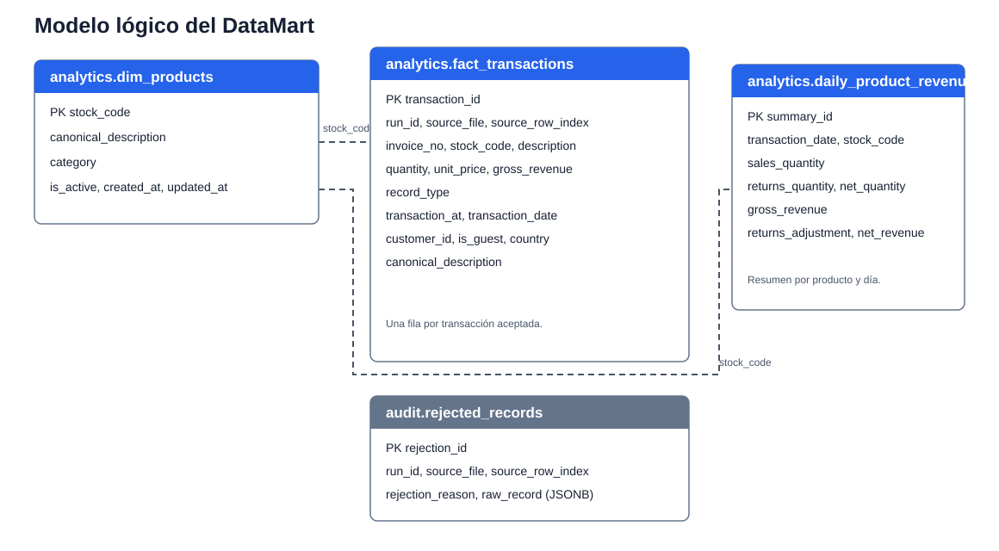
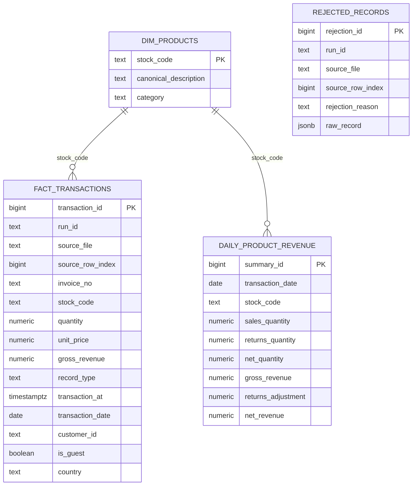
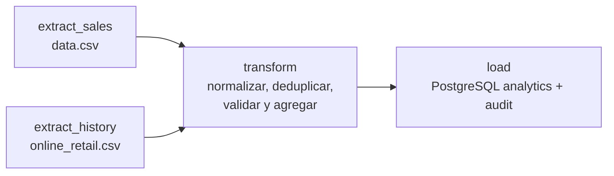

# DataMart S.A.S. – ETL Diario de Ventas con Apache Airflow

Pipeline de extracción, limpieza, validación y carga de ventas y devoluciones
desde archivos planos (CSV) hacia un Data Warehouse analítico en PostgreSQL.

**Flujo:** `extract → transform → load`

---

## 📋 Tabla de contenidos

1. [Estructura del proyecto](#estructura-del-proyecto)
2. [Requisitos previos](#requisitos-previos)
3. [Paso a paso: ejecutar todo en orden](#paso-a-paso-ejecutar-todo-en-orden)
4. [Verificar los datos en DBeaver](#verificar-los-datos-en-dbeaver)
5. [Consultas SQL útiles](#consultas-sql-útiles)
6. [Reglas de negocio implementadas](#reglas-de-negocio-implementadas)
7. [Casos ambiguos y decisiones tomadas](#casos-ambiguos-y-decisiones-tomadas)
8. [Perfil de calidad y tratamiento](#perfil-de-calidad-y-tratamiento)
9. [Modelo analítico y decisiones de carga](#modelo-analítico-y-decisiones-de-carga)
10. [Solución de problemas comunes](#solución-de-problemas-comunes)
11. [Arquitectura del pipeline](#arquitectura-del-pipeline)

---

## 📁 Estructura del proyecto

```text
Airflow2/
├── dags/
│   └── first_dag.py              # Orquestación de Airflow
├── src/
│   └── datamart/                 # Lógica ETL independiente de Airflow
│       ├── __init__.py
│       ├── extract.py
│       ├── transform.py
│       ├── validate.py
│       ├── revenue.py
│       └── load.py
├── data/
│   ├── raw/                      # CSV originales (data.csv y online_retail.csv)
│   └── processed/                # Parquet/JSON generados por ejecución
├── sql/
│   └── init/
│       └── tablas.sql             # Inicialización del Data Warehouse
├── config/
│   └── airflow.cfg
├── plugins/
├── logs/                          # Logs locales ignorados por Git
├── docker-compose.yml
├── pyproject.toml
├── uv.lock
├── .python-version
├── .env.example
├── .gitignore
├── modelo-datos.svg
└── README.md
```

---

## ⚙️ Requisitos previos

- Docker y Docker Compose instalados
- Navegador web para acceder a la UI de Airflow
- Opcional: DBeaver (o cualquier cliente PostgreSQL) para consultar los datos

---

## 🚀 Paso a paso: ejecutar todo en orden

Sigue estos pasos exactamente en el orden indicado.

### Paso 1: Configurar variables de entorno

Copia el archivo de ejemplo y ajusta los valores si es necesario:

```powershell
Copy-Item .env.example .env
```

Antes de levantar Docker, genera una clave Fernet válida y reemplaza el valor de `AIRFLOW_FERNET_KEY` en `.env`:

```powershell
docker run --rm apache/airflow:3.1.5 python -c "from cryptography.fernet import Fernet; print(Fernet.generate_key().decode())"
```

El archivo `.env` real no se incluye en el ZIP por seguridad.

Variables importantes en `.env`:

| Variable         | Descripción                          | Valor por defecto         |
| ---------------- | ------------------------------------- | ------------------------- |
| `DW_USER`      | Usuario del Data Warehouse            | `admin_dw`              |
| `DW_PASSWORD`  | Contraseña del DW                    | `analytics_password`    |
| `DW_DB`        | Nombre de la base analítica          | `data_warehouse`        |
| `AIRFLOW_IMAGE_NAME` | Imagen de Airflow que usarán los servicios | `apache/airflow:3.1.5` |

---

### Paso 2: Levantar los servicios con Docker

Desde la carpeta raíz del proyecto (`Airflow2/`), ejecuta:

```powershell
docker compose up -d
```

Compose usa la imagen indicada por `AIRFLOW_IMAGE_NAME` en `.env` y levanta:

| Servicio                  | Puerto | Propósito                   |
| ------------------------- | ------ | ---------------------------- |
| `postgres`              | 5434   | Base de metadatos de Airflow |
| `postgres-analytics`    | 5433   | Data Warehouse analítico    |
| `airflow-apiserver`     | 8080   | UI y API de Airflow          |
| `airflow-scheduler`     | —     | Programador de DAGs          |
| `airflow-dag-processor` | —     | Procesador de DAGs           |
| `airflow-triggerer`     | —     | Manejador de triggers        |

Comprueba el estado de los servicios:

```powershell
docker compose ps
```

Airflow y la base de metadatos muestran `healthy` cuando pasan sus healthchecks.
`postgres-analytics` no tiene uno configurado, por lo que su estado aparecerá
como `Up`; verifica que acepte conexiones con:

```powershell
docker compose exec postgres-analytics pg_isready -U admin_dw -d data_warehouse
```

La imagen usada por los contenedores es la definida en `AIRFLOW_IMAGE_NAME`.
`uv sync` instala dependencias en el entorno local del proyecto, pero Compose
no lee `uv.lock` ni monta `.venv`; asegúrate de que la imagen configurada tenga
las dependencias que necesita el DAG (Pandas, NumPy, PyArrow y psycopg2).

---

### Paso 3: Verificar la inicialización de la base de datos analítica

Al crear el volumen analítico por primera vez, PostgreSQL ejecuta
automáticamente `sql/init/tablas.sql`.

#### Si el volumen analítico ya existía

1. Abre DBeaver.
2. Crea una nueva conexión a PostgreSQL:
   - Host: `localhost`
   - Puerto: `5433`
   - Base de datos: `data_warehouse`
   - Usuario: `admin_dw`
   - Contraseña: `analytics_password`
3. Abre el archivo `sql/init/tablas.sql` y ejecútalo contra la base analítica.
   Los scripts de inicialización no vuelven a ejecutarse sobre un volumen ya
   creado.

```bash
docker compose exec postgres-analytics psql -U admin_dw -d data_warehouse -f /docker-entrypoint-initdb.d/tablas.sql
```

#### Verificar Connections y Variables de Airflow

Compose registra la conexión `analytics_db` y las variables `RAW_CSV_PATH` y
`PROCESSED_PATH` sin pasos en la UI. Compruébalas antes de ejecutar el DAG:

```powershell
docker compose exec airflow-scheduler airflow connections get analytics_db
docker compose exec airflow-scheduler airflow variables get RAW_CSV_PATH
docker compose exec airflow-scheduler airflow variables get PROCESSED_PATH
```

---

### Paso 4: Activar y ejecutar el DAG en Airflow

1. Abre tu navegador en: `http://localhost:8080`
2. Inicia sesión con:
   - Usuario: `admin`
   - Contraseña: `admin_password` (o los valores de tu `.env`)
3. En el menú izquierdo, haz clic en **DAGs**.
4. Busca el DAG llamado **`datamart_etl_ventas`**.
5. Activa el interruptor (toggle) para ponerlo en **Unpaused** (activo).
6. Haz clic en el nombre del DAG para abrir su detalle.
7. Arriba a la derecha, haz clic en **Trigger DAG** (botón de ejecutar).
8. Se creará una nueva ejecución con un `run_id` automático.

---

### Paso 5: Monitorear la ejecución

1. En la página del DAG, verás el grafo con las cuatro tareas:
   - `extract_sales`
   - `extract_history`
   - `transform`
   - `load`
2. Espera a que todas pasen a estado **Success** (verde con círculo blanco).
3. Si alguna tarea falla (rojo), haz clic en ella y luego en **Logs** para ver el error.

---

## 🔍 Verificar los datos en DBeaver

Una vez que el DAG termine exitosamente, abre DBeaver, conéctate a `localhost:5433` (base `data_warehouse`) y ejecuta estas consultas para confirmar que los datos llegaron:

```sql
-- 1. Cuántas transacciones válidas se cargaron
SELECT COUNT(*) AS total_transacciones
FROM analytics.fact_transactions;

-- 2. Ver cuántas son ventas vs devoluciones
SELECT
    record_type,
    COUNT(*) AS cantidad_registros,
    SUM(quantity) AS unidades,
    SUM(gross_revenue) AS revenue_total
FROM analytics.fact_transactions
GROUP BY record_type;

-- 3. Ver revenue neto por producto y día (primeros 20)
SELECT
    transaction_date,
    stock_code,
    canonical_description,
    sales_quantity,
    returns_quantity,
    net_quantity,
    gross_revenue,
    returns_adjustment,
    net_revenue
FROM analytics.daily_product_revenue
ORDER BY transaction_date DESC, stock_code
LIMIT 20;

-- 4. Ver cuántos rechazos hay y por qué motivo
SELECT
    rejection_reason,
    COUNT(*) AS cantidad_rechazos
FROM audit.rejected_records
GROUP BY rejection_reason;

-- 5. Ver productos en el catálogo canónico
SELECT *
FROM analytics.dim_products
ORDER BY stock_code
LIMIT 50;
```

Si ves filas, el pipeline funcionó correctamente.

---

## 📊 Consultas SQL para las preguntas de negocio

Cada consulta siguiente responde una pregunta del enunciado.

### 1. Evolución mensual de ventas netas

```sql
SELECT
    DATE_TRUNC('month', transaction_date)::DATE AS sales_month,
    SUM(net_revenue) AS net_revenue
FROM analytics.daily_product_revenue
GROUP BY 1
ORDER BY 1;
```

### 2. Revenue bruto y proporción de devoluciones por categoría

Las devoluciones se expresan como revenue positivo para facilitar la lectura;
la proporción se calcula frente al revenue bruto de ventas.

```sql
SELECT
    p.category,
    SUM(CASE WHEN f.record_type = 'sale'
             THEN f.gross_revenue ELSE 0 END) AS gross_revenue,
    SUM(CASE WHEN f.record_type = 'return_or_adjustment'
             THEN ABS(f.gross_revenue) ELSE 0 END) AS returned_revenue,
    ROUND(
        100.0 * SUM(CASE WHEN f.record_type = 'return_or_adjustment'
                         THEN ABS(f.gross_revenue) ELSE 0 END)
        / NULLIF(SUM(CASE WHEN f.record_type = 'sale'
                          THEN f.gross_revenue ELSE 0 END), 0),
        2
    ) AS return_rate_pct
FROM analytics.fact_transactions AS f
JOIN analytics.dim_products AS p USING (stock_code)
GROUP BY p.category
ORDER BY gross_revenue DESC;
```

### 3. Diez productos con mayor revenue neto y mayor tasa de devolución

```sql
WITH product_metrics AS (
    SELECT
        stock_code,
        MAX(canonical_description) AS canonical_description,
        SUM(gross_revenue) AS net_revenue,
        SUM(CASE WHEN record_type = 'sale'
                 THEN quantity ELSE 0 END) AS sold_quantity,
        ABS(SUM(CASE WHEN record_type = 'return_or_adjustment'
                     THEN quantity ELSE 0 END)) AS returned_quantity
    FROM analytics.fact_transactions
    GROUP BY stock_code
)
SELECT stock_code, canonical_description, net_revenue
FROM product_metrics
ORDER BY net_revenue DESC
LIMIT 10;

WITH product_metrics AS (
    SELECT
        stock_code,
        MAX(canonical_description) AS canonical_description,
        SUM(CASE WHEN record_type = 'sale'
                 THEN quantity ELSE 0 END) AS sold_quantity,
        ABS(SUM(CASE WHEN record_type = 'return_or_adjustment'
                     THEN quantity ELSE 0 END)) AS returned_quantity
    FROM analytics.fact_transactions
    GROUP BY stock_code
)
SELECT
    stock_code,
    canonical_description,
    sold_quantity,
    returned_quantity,
    ROUND(100.0 * returned_quantity / NULLIF(sold_quantity, 0), 2)
        AS return_rate_pct
FROM product_metrics
WHERE sold_quantity > 0
ORDER BY return_rate_pct DESC
LIMIT 10;
```

### 4. Países con más facturas de venta y ticket promedio

```sql
WITH invoice_sales AS (
    SELECT country, invoice_no, SUM(gross_revenue) AS ticket
    FROM analytics.fact_transactions
    WHERE record_type = 'sale'
    GROUP BY country, invoice_no
)
SELECT
    country,
    COUNT(*) AS sales_invoice_count,
    ROUND(AVG(ticket), 2) AS average_sales_ticket
FROM invoice_sales
GROUP BY country
ORDER BY sales_invoice_count DESC;
```

### 5. Comportamiento de clientes identificados y sin ID

```sql
SELECT
    CASE WHEN is_guest THEN 'Sin customer ID' ELSE 'Identificado' END
        AS customer_segment,
    COUNT(*) AS transactions,
    COUNT(DISTINCT invoice_no) AS invoices,
    SUM(quantity) AS net_quantity,
    SUM(gross_revenue) AS net_revenue
FROM analytics.fact_transactions
GROUP BY is_guest
ORDER BY is_guest;
```

### 6. Variaciones de descripción y códigos de producto únicos

```sql
SELECT
    stock_code,
    COUNT(DISTINCT UPPER(TRIM(description))) AS description_variants,
    MAX(canonical_description) AS canonical_description
FROM analytics.fact_transactions
WHERE description IS NOT NULL
GROUP BY stock_code
HAVING COUNT(DISTINCT UPPER(TRIM(description))) > 1
ORDER BY description_variants DESC, stock_code;

SELECT COUNT(DISTINCT stock_code) AS unique_product_codes
FROM analytics.fact_transactions;
```

### 7. Datos para respaldar una recomendación al equipo de producto

Prioriza la revisión de productos con ventas suficientes y alta proporción de
unidades devueltas. La salida ofrece valores medibles para fundamentar la
recomendación y evita tomar decisiones con productos de una sola venta.

```sql
SELECT
    stock_code,
    MAX(canonical_description) AS canonical_description,
    SUM(CASE WHEN record_type = 'sale'
             THEN quantity ELSE 0 END) AS sold_quantity,
    ABS(SUM(CASE WHEN record_type = 'return_or_adjustment'
                 THEN quantity ELSE 0 END)) AS returned_quantity,
    ROUND(
        100.0 * ABS(SUM(CASE WHEN record_type = 'return_or_adjustment'
                             THEN quantity ELSE 0 END))
        / NULLIF(SUM(CASE WHEN record_type = 'sale'
                          THEN quantity ELSE 0 END), 0),
        2
    ) AS return_rate_pct
FROM analytics.fact_transactions
GROUP BY stock_code
HAVING SUM(CASE WHEN record_type = 'sale' THEN quantity ELSE 0 END) >= 100
ORDER BY return_rate_pct DESC
LIMIT 10;
```

```sql
SELECT schema_name FROM information_schema.schemata
WHERE schema_name IN ('analytics', 'audit');
```

---

## 📐 Reglas de negocio implementadas

| Regla                          | Descripción                                                                                                                                           |
| ------------------------------ | ------------------------------------------------------------------------------------------------------------------------------------------------------ |
| **Cantidad ≤ 0**        | Toda transacción con cantidad menor o igual a cero se trata como devolución o ajuste, nunca como venta.                                              |
| **Precio unitario ≤ 0** | En una venta válida, el precio unitario no puede ser cero ni negativo. Los registros que incumplan esta condición se rechazan con motivo registrado. |
| **Fechas a UTC**         | `InvoiceDate` se interpreta como UTC (la fuente no aporta zona horaria) y se guarda como `transaction_at` en UTC.                                     |
| **Códigos de producto** | Se normalizan a mayúsculas y sin espacios antes de cruzarlos con la dimensión de productos.                                                             |
| **Categoría**            | Se asigna mediante reglas heurísticas sobre la descripción canónica; lo no identificado queda como `Sin categoría`.                                    |
| **Revenue bruto**        | Se calcula como `Quantity × UnitPrice`.                                                                                                             |
| **Revenue neto**         | Revenue bruto menos cualquier ajuste por devolución asociada al mismo código de producto en el mismo periodo diario.                                 |

---

## ❓ Casos ambiguos y decisiones tomadas

### 1. Transacciones sin Customer ID

**Decisión:** Se incluyen con `customer_id = 'GUEST'` y se marcan con
`is_guest = True`. En cada CSV hay 135.080 identificadores nulos de 541.909
filas (aproximadamente 24,9 %); excluirlos sesgaría los reportes de ventas.

### 2. Nombre canónico de productos

**Decisión:** Se elige la **moda** (descripción más frecuente) en **MAYÚSCULAS** por `StockCode`.
**Ejemplo:** `"CANDLE HOLDER WHITE" / "Candle Holder White" / "candle holder white" → "CANDLE HOLDER WHITE"`

### 3. Duplicados entre las dos fuentes de Kaggle

**Decisión:** `data.csv` tiene prioridad.
**Clave compuesta:** `(InvoiceNo, StockCode, InvoiceDate, Quantity, UnitPrice, CustomerID, Country)`.
Se conserva el primer registro según la prioridad de la fuente y se registran
los duplicados exactos observados durante la extracción.

### 4. Categoría del producto

Los CSV no incluyen una categoría de catálogo. Se aplica una heurística
determinista sobre la descripción canónica normalizada:
palabras asociadas a Papelería, Ropa, Deportes, Electrónica y Hogar. La
clasificación no es un catálogo oficial; los productos sin una coincidencia
clara quedan en `Sin categoría`. La regla se mantiene en `transform.py` para
que pueda revisarse y sustituirse por una relación oficial cuando exista.

## 🧹 Perfil de calidad y tratamiento

En cada fuente se observaron 5.268 filas duplicadas exactas, 1.454
descripciones nulas, 135.080 `CustomerID` nulos y 10.624 transacciones con
cantidad menor o igual a cero. La extracción registra en los logs columnas,
tipos, nulos por columna, rangos de cantidad/precio, países distintos y
duplicados.

Con los dos archivos actuales, la transformación conserva 536.639 filas tras
la deduplicación; 535.463 pasan la validación y 1.176 se guardan como
rechazadas. Se obtienen 3.958 códigos de producto y 278.942 agregados
producto-día. Con las reglas actuales, el revenue neto total calculado es
9.747.579,22. Estos conteos describen los archivos presentes y pueden cambiar
si se actualizan.

- CustomerID nulo: se sustituye por `GUEST`.
- Descripción nula o ausente del mapa: se representa como `UNKNOWN`.
- `InvoiceNo`, `StockCode`, fecha, cantidad o precio inválidos: se rechaza y
  se guarda con motivo en `audit.rejected_records`.
- Venta con precio unitario menor o igual a cero: se rechaza.
- Devolución o ajuste con cantidad menor o igual a cero: se conserva y se
  registra como `return_or_adjustment`.

## 🧱 Modelo analítico y decisiones de carga

- `analytics.dim_products`: catálogo canónico de producto con categoría.
- `analytics.fact_transactions`: una fila por transacción aceptada, con
  procedencia y revenue firmado. El dataset no contiene una columna de moneda;
  no se realiza conversión monetaria.
- `analytics.daily_product_revenue`: suma diaria por producto, con revenue de
  ventas, ajustes de devoluciones y revenue neto.
- `audit.rejected_records`: filas rechazadas, fuente y motivo.

Las agregaciones de revenue neto se calculan como revenue de ventas más el
ajuste (negativo) de devoluciones por producto y día.

### Diagrama lógico





Las líneas entre las tablas representan relaciones lógicas por `stock_code`.
El DDL actual no declara claves foráneas para imponerlas en PostgreSQL.

### Idempotencia

`max_active_runs=1` evita que dos cargas de este DAG se solapen. Cada carga
reemplaza las transacciones y rechazos de los archivos fuente, y refresca por
completo las dimensiones de productos y el resumen diario dentro de
transacciones de PostgreSQL. Reintentar una ejecución con los mismos archivos
produce el mismo estado final en las tablas analíticas.

Las operaciones de cada tabla tienen su propia transacción; las tareas del DAG
no forman una transacción global única. Si una ejecución falla entre tareas,
un reintento vuelve a reemplazar los datos de las fuentes y deja los agregados
alineados con la carga que finaliza correctamente.

---

## ⚠️ Solución de problemas comunes

| Problema | Causa | Solución |
| --- | --- | --- |
| `schema "analytics" does not exist` | El esquema no se creó en el volumen existente. | Ejecuta `sql/init/tablas.sql` en DBeaver o con el comando del Paso 3. Reiniciar el contenedor no vuelve a ejecutar la inicialización del volumen. |
| El DAG no aparece en la UI | El procesador no ha cargado el archivo o hay un error de importación. | Comprueba `docker compose ps` y los logs de `airflow-dag-processor`; después consulta `airflow dags list` dentro del scheduler. |
| Tarea `load` falla | Conexión o credenciales de PostgreSQL incorrectas. | Verifica `analytics_db`, las credenciales de `.env` y que `postgres-analytics` acepte conexiones en el puerto 5433. |

---

## 🏗️ Arquitectura del pipeline



### Módulos de lógica de negocio (`src/datamart/`)

| Archivo          | Responsabilidad                                                                                               |
| ---------------- | ------------------------------------------------------------------------------------------------------------- |
| `extract.py`   | Lectura de CSV y combinación de fuentes                                                                      |
| `transform.py` | Deduplicación, normalización de códigos, fechas UTC, clasificación, customer ID, descripciones canónicas |
| `validate.py`  | Validación de precios y separación de rechazos                                                              |
| `revenue.py`   | Revenue bruto y resumen diario neto                                                                           |
| `load.py`      | Conexión y carga a PostgreSQL                                                                                |

---
